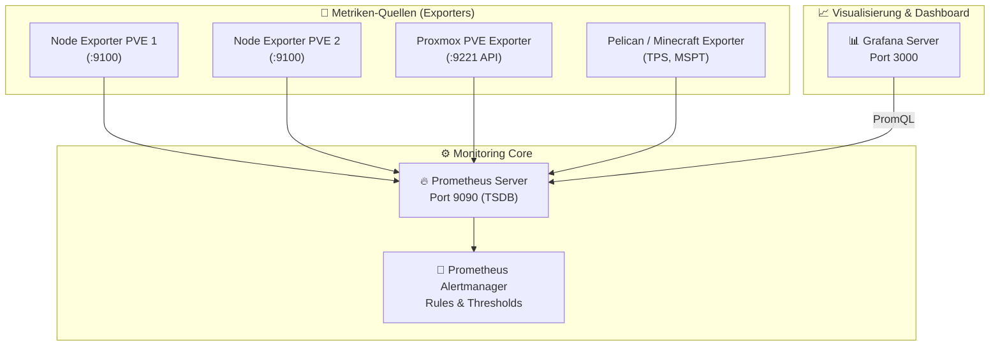

# 📊 Homelab Observability & Monitoring Stack

[](https://prometheus.io/)
[](https://grafana.com/)
[](docker-compose.yml)
[](#-alerting-regeln)

Kompletter, vorkonfigurierter **Observability- & Monitoring-Stack** für den **Proxmox VE Cluster**, Hypervisor-Metriken, ZFS-Speicherzustände und virtualisierte Gaming-Workloads.

---

## 🏗️ Metriken-Architektur



---

## ⚡ Enthaltene Komponenten

1. **Prometheus v2.50:** Zentraler Time-Series-Speicher mit 30 Tagen Datenhaltung.
2. **Grafana v10.4:** Moderne Visualisierung mit automatischem Provisioning von Data-Sources und Dashboards.
3. **Node Exporter:** Tiefgehende Hardware-Telemetrie (CPU-Kerne, RAM-Auslastung, Festplatten-I/O, Netzwerk-Durchsatz).
4. **Proxmox PVE Exporter:** Aggregierte Cluster-, Node-, VM- und LXC-Zustände direkt über die Proxmox API.
5. **Vordefinierte Alerts:** Alarmierung bei Knotenausfall (`HostDown`), CPU-Dauerlast (>90%) und kritischem Festplattenspeicher (<10%).

---

## 🚀 Schnelleinstieg

1. Repository klonen:
   ```bash
   git clone https://github.com/Hannes-frbg/homelab-monitoring.git
   cd homelab-monitoring
   ```

2. Konfiguration vorbereiten:
   ```bash
   cp .env.example .env
   cp pve_exporter/pve.yml.example pve_exporter/pve.yml
   ```
   *(Trage in `pve_exporter/pve.yml` dein Proxmox API-Token ein)*

3. Stack starten:
   ```bash
   docker compose up -d
   ```

4. Grafana aufrufen:
   - URL: `http://<DEINE-SERVER-IP>:3000`
   - Standard-Login: `admin` / *(dein gesetztes Passwort aus `.env`)*
   - Das Dashboard **"Proxmox VE Cluster Health"** ist bereits vorkonfiguriert und einsatzbereit!

---

## 🛡️ Vorkonfigurierte Dashboards & Alerts

- **Proxmox Cluster Health:** CPU-, RAM- und Speicherauslastung beider Nodes (AMD Ryzen 5 5600GT & Intel i5-7500T) im direkten Vergleich.
- **Alerting Rules:** Automatische Erkennung von Speichermangel und degradierten ZFS-Pools.

---
*Gepflegt im Hannes-frbg Homelab Cluster*
